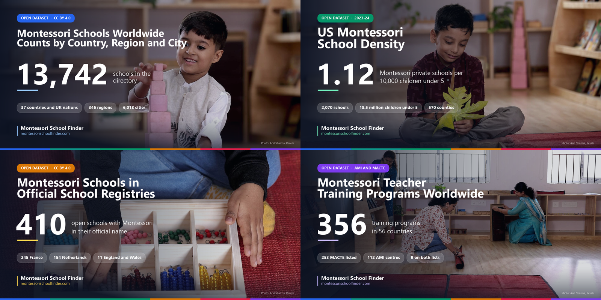

# Montessori Schools Open Data

Open, documented datasets about Montessori schools around the world, published by **[Montessori School Finder](https://www.montessorischoolfinder.com/)**, the worldwide directory of Montessori schools. Every dataset comes as clean CSV files with a data dictionary, a starter notebook, the code that rebuilds it and a plain account of its limits. All are free to reuse under **CC BY 4.0**.

## The Datasets

| Dataset | What it answers | Key number |
|---|---|---|
| **[Montessori Schools Worldwide: Counts by Country, Region and City](https://github.com/montessoritheory/montessori-schools-worldwide-counts)** | How many Montessori schools are there, and where? | 13,742 schools in 37 countries |
| **[US Montessori School Density by State and County](https://github.com/montessoritheory/us-montessori-school-density)** | Which states have the most Montessori schools for their young children? | 1.12 schools per 10,000 children under 5 |
| **[Montessori Schools in Official School Registries](https://github.com/montessoritheory/montessori-schools-official-registries)** | Which schools do the governments of France, the Netherlands, England and Wales list as Montessori? | 410 open schools |
| **[Montessori Teacher Training Programs Worldwide](https://github.com/montessoritheory/montessori-teacher-training-programs)** | Where can you train as a Montessori teacher with AMI or a MACTE accredited program? | 356 programs in 56 countries |

## How These Datasets Are Built

- **Official sources first.** School registries of three governments, the NCES Private School Universe Survey, the US Census Bureau, the MACTE accredited program search and the AMI list of training centres.
- **Directory counts, never directory records.** The worldwide dataset holds counts only. School names, addresses, ratings and reviews from the directory are never republished.
- **Checked against the source.** Each dataset says what was checked, how, and what the numbers cannot tell you.

## Find A School

Every place in these datasets links to its page on Montessori School Finder, where the schools themselves are listed:

- [Montessori schools by country](https://www.montessorischoolfinder.com/locations/)
- [Montessori schools in the United States, state by state](https://www.montessorischoolfinder.com/locations/united-states/)
- [Montessori teacher training centers](https://www.montessorischoolfinder.com/montessori-certifications/training-centers/)
- [Montessori school statistics](https://www.montessorischoolfinder.com/montessori-school-statistics/)

## License And Credit

All datasets are under **[CC BY 4.0](https://creativecommons.org/licenses/by/4.0/)**. Credit **Montessori School Finder** with a link to [montessorischoolfinder.com](https://www.montessorischoolfinder.com/), along with the original sources named in each dataset.
